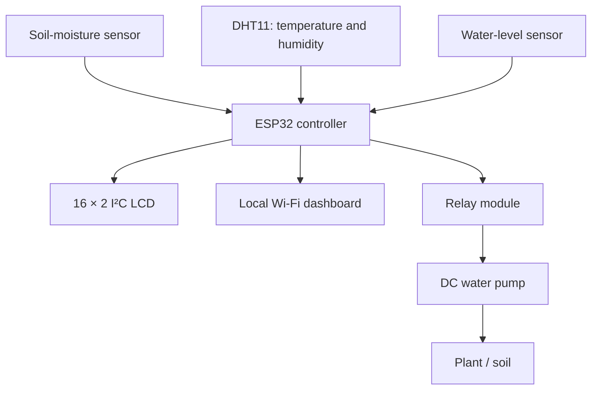

# 🌱 ESP32 Smart Plant Watering System

**Automatic Irrigation with Soil Monitoring, Water-Level Protection, LCD Display & Local Web Dashboard**


---

## 📖 Overview

The **ESP32 Smart Plant Watering System** is an embedded and IoT-based automatic irrigation prototype designed to monitor plant and environmental conditions and supply water only when required.

The system uses an **ESP32 DevKit V1** as the main controller. It continuously monitors:

- Soil moisture
- Temperature
- Humidity
- Water-tank level
- Estimated pH indication

Based on the measured soil-moisture percentage, the ESP32 automatically controls a **DC water pump through a relay module**.

The prototype also includes a **16×2 I2C LCD** for local monitoring and a responsive **local web dashboard** hosted directly by the ESP32.

No internet connection or cloud platform is required. The ESP32 creates its own Wi-Fi network, allowing a phone or laptop to connect directly to the system.

---

## 📸 System Image


## 🎥 Demonstration Video

[▶ Watch the smart plant watering demonstration on YouTube](https://youtu.be/S9Hl_D69ZGY)

---

## ✨ Key Features

- 🌱 Real-time soil-moisture monitoring
- 🌡️ Temperature monitoring using DHT11
- 💧 Humidity monitoring
- 🚰 Water-tank level detection
- ⚙️ Automatic relay-controlled water pump
- 🖥️ 16×2 I2C LCD monitoring
- 📡 ESP32 local Wi-Fi Access Point
- 🌐 Responsive real-time web dashboard
- 🛡️ Empty-tank pump protection
- ⏱️ Maximum pump runtime safety protection
- 🔄 Automatic hysteresis-based irrigation control
- 📊 Soil condition classification
- 🧪 Estimated pH indication for prototype demonstration
- 📱 Dashboard accessible from phone, tablet or laptop
- 🔌 No cloud or internet dependency

---

## 🏗️ System Architecture



---

## 🧰 Hardware Components

| Component | Quantity | Purpose |
|---|---:|---|
| ESP32 DevKit V1 | 1 | Main controller and Wi-Fi server |
| Soil Moisture Sensor | 1 | Measures soil moisture |
| DHT11 | 1 | Temperature and humidity sensing |
| Water Level Sensor | 1 | Monitors tank water availability |
| 16×2 LCD with I2C Module | 1 | Local system monitoring |
| Relay Module | 1 | Controls water pump |
| DC Water Pump | 1 | Supplies water to plant |
| Water Tank / Container | 1 | Water reservoir |
| Water Tube | 1 | Water delivery |
| External Pump Supply | 1 | Powers pump |
| Jumper Wires | As required | Electrical connections |
| Plywood / Mounting Base | 1 | Prototype mounting |

---

## 🔌 ESP32 Pin Configuration

| Device | Signal | ESP32 Pin |
|---|---|---|
| DHT11 | DATA | GPIO 4 |
| Soil Moisture Sensor | Analog Output | GPIO 34 |
| Water Level Sensor | Analog Output | GPIO 35 |
| Relay Module | IN | GPIO 26 |
| I2C LCD | SDA | GPIO 21 |
| I2C LCD | SCL | GPIO 22 |

---

## ⚡ Power Connections

### Soil Moisture Sensor

```text
VCC  → 3.3V
GND  → GND
AO   → GPIO 34
```

### Water Level Sensor

```text
VCC → 3.3V
GND → GND
AO  → GPIO 35
```

### DHT11

```text
VCC  → 3.3V / 5V
GND  → GND
DATA → GPIO 4
```

### 16×2 I2C LCD

```text
VCC → 5V
GND → GND
SDA → GPIO 21
SCL → GPIO 22
```

### Relay Module

```text
IN  → GPIO 26
GND → Common GND
VCC → According to relay-module rating
```

The relay used in the prototype operates using **active-LOW control**.

---

## 🚿 Pump Wiring

The water pump is powered from an external power source and is switched through the relay.

| Connection | Destination |
| --- | --- |
| External supply positive | Relay COM |
| Relay NO | Pump positive |
| Pump negative | External supply negative |

The **NC terminal is not used**.

> ⚠️ Never power the water pump directly from an ESP32 GPIO pin.

---

## 🌱 Soil Moisture Calibration

The soil-moisture sensor was experimentally calibrated using actual dry and wet conditions.

```cpp
#define SOIL_DRY 4095
#define SOIL_WET 1500
```

The raw ADC reading is converted into a percentage:

```text
4095 → approximately 0% moisture

1500 → approximately 100% moisture
```

Lower ADC values indicate wetter soil, while higher values indicate drier soil.

Example measured values:

| Raw ADC | Approximate Condition |
|---:|---|
| 4095 | Very Dry |
| ~3250 | Dry |
| ~2100 | Moist |
| ~1800 | Very Wet |

---

## 🌿 Soil Condition Classification

| Moisture | Condition |
|---:|---|
| 0–20% | VERY DRY |
| 21–40% | DRY |
| 41–60% | NORMAL |
| 61–80% | MOIST |
| 81–100% | VERY WET |

---

## 💧 Automatic Irrigation Logic

The system uses hysteresis control to prevent rapid ON/OFF switching of the relay.

```cpp
#define PUMP_ON_THRESHOLD 35
#define PUMP_OFF_THRESHOLD 55
```

### Pump ON

```text
Soil Moisture < 35%
+
Water available in tank
        ↓
Pump ON
```

### Pump OFF

```text
Soil Moisture ≥ 55%
        ↓
Pump OFF
```

Using separate ON and OFF thresholds makes the irrigation process more stable.

---

## 🚰 Water-Level Monitoring

The water-level sensor was experimentally tested under dry and immersed conditions.

Typical readings obtained during testing:

```text
Sensor Dry        → 0
Residual Water    → ~1000
Deep in Water     → ~2200–2665
```

The following thresholds are used:

```cpp
#define WATER_EMPTY 200
#define WATER_LOW 1200
#define WATER_MEDIUM 2000
```

Classification:

| Raw Reading | Tank Status |
|---:|---|
| < 200 | EMPTY |
| 200–1199 | LOW |
| 1200–1999 | MEDIUM |
| ≥ 2000 | HIGH |

---

## 🛡️ Empty-Tank Protection

One of the key safety features is dry-run pump protection.

Even if the soil becomes dry:

```text
Tank = EMPTY
        ↓
Pump = OFF
```

This prevents the pump from operating when sufficient water is not available.

---

## ⏱️ Pump Safety Timeout

A maximum continuous pump runtime is implemented:

```cpp
#define MAX_PUMP_RUNTIME 30000UL
```

This corresponds to:

```text
30 seconds
```

If the pump remains ON continuously for 30 seconds, the ESP32 automatically turns it OFF.

This protects the prototype if abnormal sensor readings or mechanical problems occur.

---

## 🧪 Estimated pH Indication

A dedicated soil-pH sensor was not used in the prototype.

For demonstration purposes, an estimated pH indicator is generated from the soil-moisture range:

| Soil Moisture | Estimated pH |
|---:|---:|
| 0–20% | 6.4 |
| 21–40% | 6.5 |
| 41–60% | 6.7 |
| 61–80% | 6.8 |
| 81–100% | 6.9 |

Implementation:

```cpp
float estimatedPH(int moisture)
{
  if (moisture <= 20) return 6.4;
  else if (moisture <= 40) return 6.5;
  else if (moisture <= 60) return 6.7;
  else if (moisture <= 80) return 6.8;
  else return 6.9;
}
```

> **Important:** This is an estimated demonstration parameter and is **not an actual soil-pH measurement**. A dedicated pH probe must be integrated for real pH sensing.

---

## 📟 LCD Monitoring

A **16×2 I2C LCD** provides local monitoring.

After the dashboard is connected, the LCD automatically rotates through four information pages.

### Page 1

```text
Moist:48%
pH(est):6.7
```

### Page 2

```text
Temp:29.3C
Hum:78%
```

### Page 3

```text
Tank:HIGH
Pump:OFF
```

### Page 4

```text
Soil:NORMAL
Auto Mode
```

---

## 📡 ESP32 Local Wi-Fi Network

The ESP32 creates its own Wi-Fi Access Point.

```text
SSID: SmartWatering
```

This allows the dashboard to operate without an internet connection.

Typical default ESP32 Access Point IP:

```text
192.168.4.1
```

---

## 🖥️ Smart LCD/IP Behaviour

During startup:

```text
Smart Watering
Starting...
```

The ESP32 then displays:

```text
Connect WiFi:
SmartWatering
```

Afterward, the LCD displays the dashboard IP:

```text
Dashboard IP:
192.168.4.1
```

The IP remains visible until a browser successfully opens the dashboard.

After connection:

```text
Dashboard
Connected!
```

The LCD then switches automatically to normal sensor-page rotation.

---

## 🌐 Local Web Dashboard

The ESP32 hosts a responsive web dashboard using its built-in web server.

The dashboard displays:

- Soil moisture percentage
- Estimated pH
- Temperature
- Humidity
- Soil condition
- Water-tank status
- Pump state
- Automatic irrigation mode
- Pump ON threshold
- Pump OFF threshold
- Live system connection state
- Last dashboard update time

The page automatically refreshes sensor information approximately every:

```text
1.5 seconds
```

---

## 📱 Opening the Dashboard

### Step 1

Power ON the ESP32.

### Step 2

Open Wi-Fi settings on a phone or laptop.

### Step 3

Connect to:

```text
SmartWatering
```

If the device reports:

```text
No Internet
```

remain connected. This is expected because the dashboard operates locally.

### Step 4

Check the IP address shown on the LCD.

Usually:

```text
192.168.4.1
```

### Step 5

Open a browser and enter:

```text
http://192.168.4.1
```

The Smart Plant Watering dashboard will open.

---

## 💻 Software Requirements

### Arduino IDE

The firmware was developed using the Arduino IDE with ESP32 board support.

### Required Libraries

```cpp
#include <Wire.h>
#include <LiquidCrystal_I2C.h>
#include <DHT.h>
#include <WiFi.h>
#include <WebServer.h>
```

### Main Libraries

- `Wire.h`
- `LiquidCrystal_I2C.h`
- `DHT.h`
- `WiFi.h`
- `WebServer.h`

`WiFi.h` and `WebServer.h` are included with the ESP32 Arduino core.

---

## ⚙️ Firmware Workflow

1. Initialize the ESP32, LCD, sensors, relay and Wi-Fi access point.
2. Display the dashboard IP address until the browser connects.
3. Read soil moisture, temperature, humidity and water level.
4. Calculate moisture percentage, soil condition, tank state and the demonstration pH value.
5. Keep the pump OFF when the tank is empty.
6. When water is available, turn the pump ON below 35% moisture and OFF at or above 55%; retain its current state between those thresholds.
7. Check the 30-second continuous runtime limit and turn the pump OFF when reached.
8. Update the LCD and web dashboard, then repeat.

---

## 🧪 Experimental Testing

The system was tested under different conditions.

### Dry Soil

```text
Raw value: 4095
Moisture: 0%
Estimated pH: 6.4
```

Result:

```text
Soil: VERY DRY
Pump: ON
```

when water is available.

---

### Wet Soil

Measured raw values during testing included:

```text
1782
1920
1925
2087
2117
2128
```

Typical calculated moisture:

```text
75–89%
```

Result:

```text
Soil: MOIST / VERY WET
Pump: OFF
```

---

### Water Tank Test

Dry sensor:

```text
Water Raw: 0
Tank: EMPTY
```

Deeply immersed sensor:

```text
Water Raw: approximately 2200–2665
Tank: HIGH
```

---

### Temperature & Humidity Test

Example DHT11 readings:

```text
Temperature: 29.3 °C
Humidity: 78%
```

---

## ✅ Final Working Sequence

When moisture falls below **35%** and water is available, the relay turns the pump ON. Water reaches the soil until moisture reaches **55%**, the tank becomes empty, or the **30-second runtime limit** is reached; the pump then turns OFF.

---

## 🛡️ Safety Features

The project includes multiple protection mechanisms:

### Tank Protection

```text
Tank EMPTY → Pump OFF
```

### Maximum Pump Runtime

```text
Pump running ≥ 30 seconds
        ↓
Pump automatically OFF
```

### Hysteresis Control

```text
ON  < 35%
OFF ≥ 55%
```

This avoids rapid relay switching.

---

## 🚀 Installation

### 1. Install Arduino IDE

Install Arduino IDE and add ESP32 board support.

### 2. Select ESP32 Board

In Arduino IDE:

```text
Tools
→ Board
→ ESP32 Arduino
→ ESP32 Dev Module
```

### 3. Install Required Libraries

Install:

```text
LiquidCrystal_I2C
DHT sensor library
```

### 4. Connect Hardware

Follow the wiring table provided above.

### 5. Upload Firmware

Connect the ESP32 through USB.

Select the correct COM port.

Compile and upload the firmware.

### 6. Open Serial Monitor

Set:

```text
Baud Rate: 115200
```

You should see output similar to:

```text
Soil Raw: 2087
| Moisture: 77%
| pH(est): 6.8
| Temp: 29.3C
| Humidity: 78%
| Water Raw: 2475
| Tank: HIGH
| Pump: OFF
```

---

## 📊 Dashboard Features

The dashboard uses a clean responsive layout with:

- Live system indicator
- Soil-moisture progress bar
- Humidity progress bar
- Temperature card
- Estimated-pH card
- Dynamic soil-condition status
- Visual water-tank indicator
- Pump ON/OFF status
- Automatic-mode status
- System health message
- ESP32 network information
- Last-update timestamp

The interface automatically adapts to mobile and desktop screen sizes.

---

## 🎯 Applications

This project can be used as a foundation for:

- Home plant automation
- Smart gardens
- Greenhouses
- Nurseries
- Agricultural irrigation
- Indoor plants
- IoT agriculture demonstrations
- Embedded-system projects
- Water-conservation systems
- Engineering mini/final-year projects

---

## ✅ Advantages

- Automatic plant watering
- Reduces manual effort
- Reduces unnecessary water usage
- Low-cost implementation
- Real-time monitoring
- Local dashboard without cloud services
- No internet connection required
- Pump dry-run protection
- Easy hardware expansion
- Compact ESP32-based architecture
- Suitable for educational demonstrations

---

## ⚠️ Limitations

- The water-level sensor provides approximate tank states rather than an exact liquid volume.
- The DHT11 has lower accuracy than professional environmental sensors.
- Soil-moisture calibration varies depending on soil type and sensor characteristics.
- The displayed pH value is estimated and is not a true chemical pH measurement.
- The local dashboard is accessible only within ESP32 Wi-Fi range.
- The current prototype controls one plant/watering zone.

---

## 🔮 Future Improvements

Possible future developments include:

- Dedicated soil-pH sensor
- Capacitive industrial moisture probe
- BME280 environmental sensor
- Multiple plant zones
- Multiple pumps and valves
- Automatic fertilizer control
- Rain sensor integration
- Light-intensity monitoring
- Solar-powered operation
- Cloud database integration
- Historical sensor graphs
- Mobile application
- Notifications and alerts
- Remote internet monitoring
- MQTT / Firebase / cloud IoT integration
- AI-based irrigation prediction
- Weather-based watering decisions
- Water-consumption monitoring

---

## 📚 Technologies Used

- ESP32
- Embedded C/C++
- Arduino IDE
- Wi-Fi
- HTTP
- HTML
- CSS
- JavaScript
- REST-style JSON data endpoint
- I2C communication
- ADC sensing
- Relay-based load control
- Embedded web server

---

## 🎓 Project Category

```text
Embedded Systems
Internet of Things (IoT)
Smart Agriculture
Automation
Sensor Technology
Environmental Monitoring
```

---

## 📌 Project Status

```text
Hardware Integration       ✅ Completed
Sensor Calibration         ✅ Completed
Automatic Irrigation       ✅ Completed
LCD Monitoring             ✅ Completed
Water-Level Protection     ✅ Completed
Pump Safety Timeout        ✅ Completed
ESP32 Web Server           ✅ Completed
Responsive Dashboard       ✅ Completed
Prototype Testing          ✅ Completed
```

---

## Author

**Eshwar Prasad Y**

Electronics & Communication Engineering

Embedded Systems | IoT | Automotive Electronics | Arduino | Microcontrollers

Email: [eshwargowda313@gmail.com](mailto:eshwargowda313@gmail.com)

LinkedIn: [Eshwar Prasad Y](https://www.linkedin.com/in/eshwar-prasad-y-a3043b370/)

---

## 🤝 Contributing

Suggestions and improvements are welcome.

Possible contributions include:

- Improved dashboard designs
- Better irrigation algorithms
- Additional sensor integration
- Cloud monitoring
- Data logging
- Mobile applications
- Multiple-zone irrigation

---

## ⭐ Support

If you find this project useful, consider giving the repository a **⭐ Star**.

It helps others discover the project and supports further development.

---

**🌱 Smart Plant Watering System**

**Monitor → Analyze → Irrigate → Protect → Repeat**
